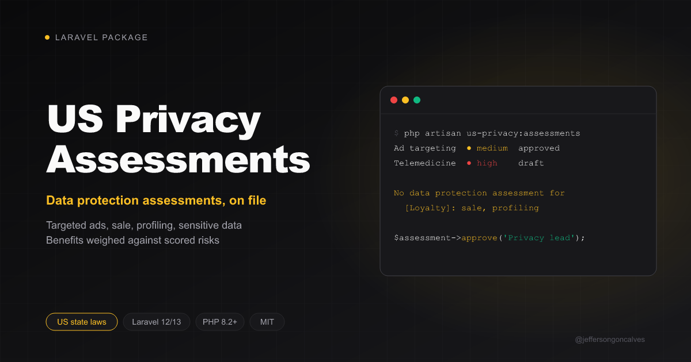

# Laravel US Privacy Assessments



[](https://packagist.org/packages/jeffersongoncalves/laravel-us-privacy-assessments)
[](https://github.com/jeffersongoncalves/laravel-us-privacy-assessments/actions/workflows/tests.yml)
[](https://packagist.org/packages/jeffersongoncalves/laravel-us-privacy-assessments)

Data protection assessments under the US state privacy laws. Every state except Utah and Iowa requires one before you process personal data for **targeted advertising**, **sell** it, use it for **profiling** with a reasonably foreseeable risk to consumers, or process **sensitive data**. The assessment weighs the benefits of the processing against the risks to consumers, as mitigated by your safeguards. You keep it and hand it to the attorney general on request.

Built on [laravel-us-privacy](https://github.com/jeffersongoncalves/laravel-us-privacy) (the personal data inventory) and [laravel-us-privacy-notices](https://github.com/jeffersongoncalves/laravel-us-privacy-notices) (the processing activities).

> This package gives you tooling. It does not make you compliant on its own.

## Installation

```bash
composer require jeffersongoncalves/laravel-us-privacy-assessments
php artisan vendor:publish --tag="us-privacy-assessments-migrations"
php artisan vendor:publish --tag="us-privacy-assessments-config"
php artisan migrate
```

## Assessments

```php
use JeffersonGoncalves\UsPrivacyAssessments\Models\DataProtectionAssessment;

$assessment = DataProtectionAssessment::create([
    'title' => 'Ad targeting',
    'processing_activity_id' => $activity->id,
    'description' => 'Browsing data sent to the ad network to target ads',
    'benefits' => 'Relevant offers for consumers; revenue that keeps the service free',
    'necessity' => 'Only page categories, never the full URL',
    'risks' => [
        ['title' => 'Inferences about health', 'threat' => 'linking', 'likelihood' => 2, 'impact' => 3,
         'measures' => 'Health pages excluded', 'residual_likelihood' => 1, 'residual_impact' => 3],
    ],
]);

$assessment->scoredRisks();   // level and residual level per risk
$assessment->highestRisk();   // RiskLevel::Medium
$assessment->approve('Privacy lead'); // next review in 1 year (review_every)
```

Risks are scored likelihood (1-3) x impact (1-3): low, medium, high, before and after the measures, with optional LINDDUN threats. Editing the content of an approved assessment sends it back to draft. Review it whenever the processing changes; Colorado expects assessments of profiling to be reviewed every year.

## What still needs one

```bash
php artisan us-privacy:assessments          # assessments, and the activities with none
php artisan us-privacy:assessments --json   # everything, ready to hand over
```

```php
use JeffersonGoncalves\UsPrivacyAssessments\Facades\UsPrivacyAssessments;

UsPrivacyAssessments::candidates(); // activities whose models are flagged targetedAdvertising, sold, profiling or sensitive
UsPrivacyAssessments::export($assessment);
```

## Testing

```bash
composer test
```

## Changelog

See [CHANGELOG](CHANGELOG.md).

## License

The MIT License (MIT). See [License File](LICENSE.md).
